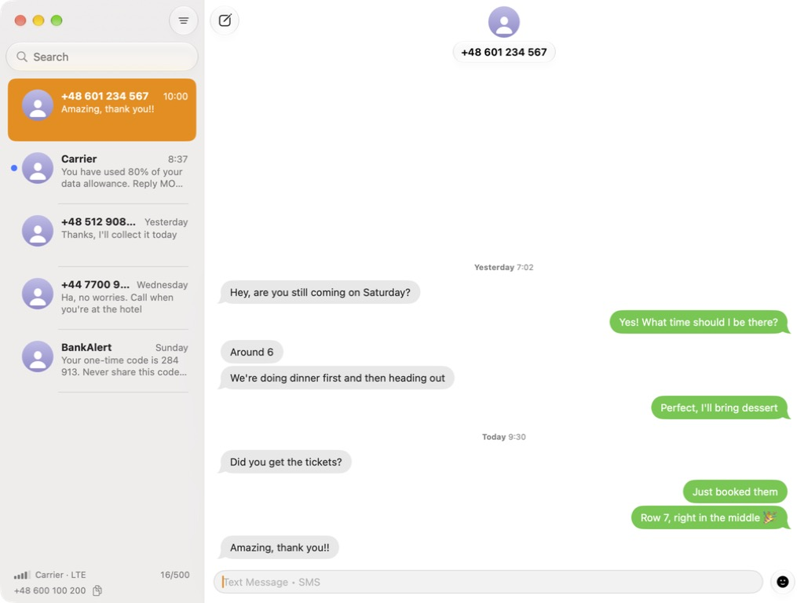

# HiLink Messages

A native macOS app for sending and receiving text messages (SMS) through a Huawei HiLink LTE USB stick. It looks and behaves like Apple's Messages app and stays in the menu bar so texts keep arriving when its window is closed.



**Documentation: <https://kludw.github.io/hilink-messages/>**

## Features

- Conversations grouped by number, with search and an unread filter
- Sending with an SMS part counter, and retry for failed messages
- A tone and a notification for new messages, with a Copy Code button for verification codes
- Names and photos from the Mac's Contacts
- A menu bar icon showing signal strength; the app keeps running with its window closed
- Clear screens for a missing stick, missing SIM or no signal
- A storage indicator that warns before the stick fills up
- Settings for login, check interval, sound and notifications
- An [OpenAPI description](openapi.yaml) of the stick's API, from which the app's API types are generated

## Requirements

- macOS 26 or later
- A Huawei LTE stick in HiLink mode with a SIM. Developed and tested with the E3372h-320; other HiLink sticks are untested.
- Xcode 26 or later to build

## Build and run

```bash
git clone https://github.com/kludw/hilink-messages.git
cd hilink-messages
scripts/bundle.sh --open
```

See [Getting started](https://kludw.github.io/hilink-messages/getting-started) for permissions and first-run setup.

## Privacy

Messages stay on the stick; the app keeps no copy on the Mac and makes no network connections other than to the stick. Details are in [How it works](https://kludw.github.io/hilink-messages/how-it-works).

## Disclaimer

This is an independent project and is not affiliated with Huawei or Apple. The stick's API is undocumented and may differ between models and firmware versions.
